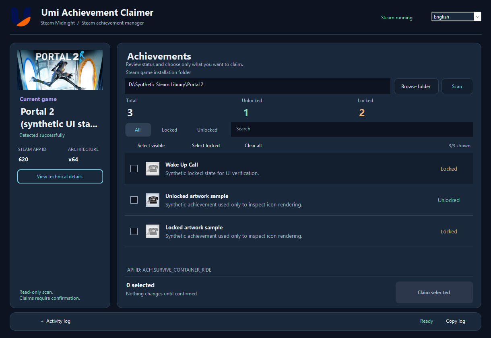

# Umi Achievement Claimer

A lightweight bilingual Windows utility for detecting Steam games, reading their achievement status and claiming only the achievements selected by the user.



Native client-area render with real public [Portal 2 artwork](https://store.steampowered.com/app/620/Portal_2/) and synthetic achievement states for UI verification. The Windows titlebar is outside this client-area capture.

## Features

- English interface by default, with Vietnamese available in the app.
- Steam Midnight dashboard with navy surfaces, lavender actions, a compact game sidebar and a fixed Claim footer.
- Black native window caption and border on Windows 11, with a compatible dark-frame fallback on Windows 10.
- Game cover artwork and achievement icons from Steam, loaded in the background. Icons are fetched only for visible results; unavailable artwork keeps the built-in fallback.
- Search achievements by name, description or API ID; filter All / Locked / Unlocked.
- Two-line achievement rows with individual checkboxes, status and full-text tooltips.
- Total, unlocked and locked counts, plus the number selected (including selections hidden by filters).
- Collapsible activity log with Copy log, and expandable technical details.
- Detects the game name, Steam AppID, installation directory and Steam API architecture.
- Reads achievement names, descriptions and locked/unlocked status before making changes.
- Select individual achievements, all visible results or the locked achievements in visible results. Clear all also clears hidden selections.
- Nothing is selected or claimed automatically.
- A dedicated confirmation shows the game, AppID and exact selected count. Cancel is the default action.
- Game switching, language and selection controls are locked while the worker is running.
- Supports x86 and x64 Steamworks games through embedded workers.
- Can detect Steam API libraries stored in common game wrappers, JAR/ZIP archives and supported embedded CAB archives.
- Supports Capcom Arcade Stadium through a compatible x64 Steam API provider already installed in the local Steam library.
- Does not edit or delete game save files.

## Download

Download `UmiAchievementClaimer.exe` from [GitHub Releases](https://github.com/TDUmii/UmiAchievementClaimer/releases/latest) and run it on Windows. The same executable is also kept in the repository root.

| Item | Value |
|---|---|
| Version | `1.6.0` |
| File | `UmiAchievementClaimer.exe` |
| Size | `264,704 bytes` |
| SHA-256 | `58DB2590579554685F2155CA30A7E92AD60E50407F329DD72579FCE4BE110CB3` |

Verify the downloaded file in PowerShell:

```powershell
Get-FileHash -Algorithm SHA256 .\UmiAchievementClaimer.exe
```

## Requirements

- Windows 10 or Windows 11, 64-bit.
- Steam running in Online mode with a valid session and game license.
- A standard or supported packaged Steamworks API used by the selected game.

## Usage

1. Close the target game and keep Steam running.
2. Open `UmiAchievementClaimer.exe` and select the game's installation folder.
3. Review the detected game and achievement list. Search or use **All / Locked / Unlocked** to narrow the results.
4. Tick individual achievements, use **Select visible**, or select the locked achievements in the visible results. Selections survive searches and filters; the footer reports how many selected items are hidden.
5. Choose **Claim selected**, check the game, AppID and count, then explicitly confirm. **Clear all** clears every selection, including hidden ones.
6. Expand **Activity log** for diagnostics and use **Copy log** when needed. **View technical details** shows the detected Steam API and stats interface.

Artwork uses public Steam metadata and Steam CDN images. It does not need an API key, and does not upload your installation path or Steam account details. An Internet connection is needed for artwork; missing images do not block scanning or selection.

## Build from source

The project uses Windows PowerShell and the .NET Framework 4.x compilers included with Windows. No NuGet packages are required.

```powershell
Set-ExecutionPolicy -Scope Process Bypass
.\build.ps1
```

The compiled application is written to `dist\UmiAchievementClaimer.exe` and copied to the repository root.

Run the native UI regression checks after building:

```powershell
.\tests\run-ui.ps1
```

The checks use synthetic game and achievement data. They do not invoke the Steam worker or change a Steam profile. Native render captures are written to the ignored `.impeccable/review/` directory. Real Steam scan/claim compatibility must be validated separately for the target game.

An optional live artwork check downloads a public Portal 2 cover and both achievement-icon states, and saves fixtures for the UI render checks:

```powershell
.\tests\run-artwork.ps1
.\tests\run-ui.ps1 -SkipBuild
```

The UI checks also verify that supported Windows builds accept the black frame-color requests and enable DWM dark mode. `DrawToBitmap` captures the application's client content; it does not prove the composed Windows titlebar's pixel colors. The 150% check simulates geometry and font scaling, rather than testing a physical display at that DPI.

See [release notes](docs/CHANGELOG.md) and [architecture](docs/ARCHITECTURE.md) for implementation details.

## Project structure

```text
src/       Application, detection, UI and worker source code
assets/    Umi logo and Windows icon
tools/     Brand asset preparation script
docs/      Architecture notes
build.ps1  Build script
```

## Compatibility notes

- Server-authoritative achievements, anti-cheat protected games and encrypted or custom Steam API implementations may reject or prevent achievement changes.
- Third-party launchers, DLC and account-linking requirements still apply.
- Steam Families games use the borrowing player's own Steam achievement profile.
- The app reports unsupported protected game builds instead of attempting unsafe runtime-memory extraction.

## Important

Claiming achievements changes Steam profile data and may not be fully reversible. Use the tool only with games and Steam accounts you are authorized to access.

Việc claim achievement sẽ thay đổi dữ liệu hồ sơ Steam và có thể không hoàn tác hoàn toàn. Chỉ sử dụng ứng dụng với game và tài khoản Steam mà bạn có quyền truy cập.

## License

No license is currently included.
