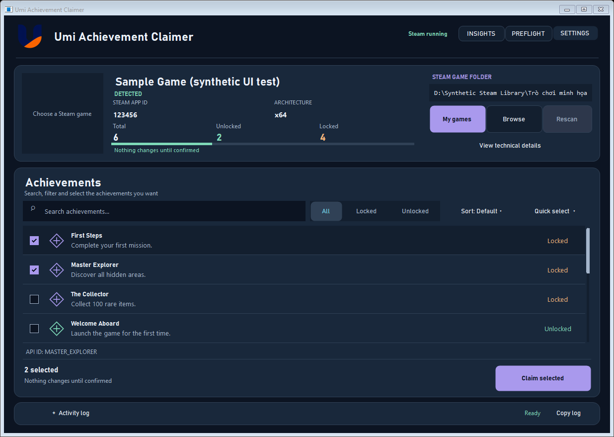
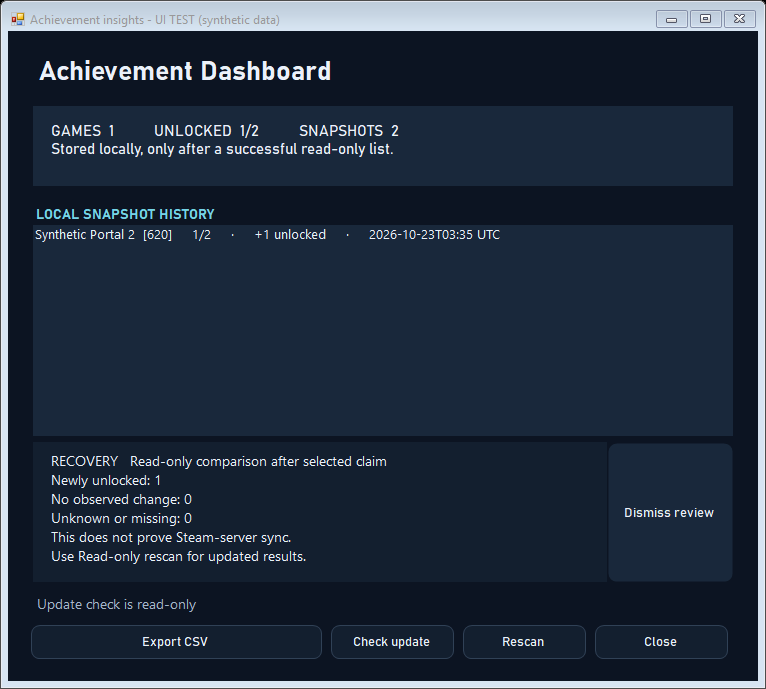
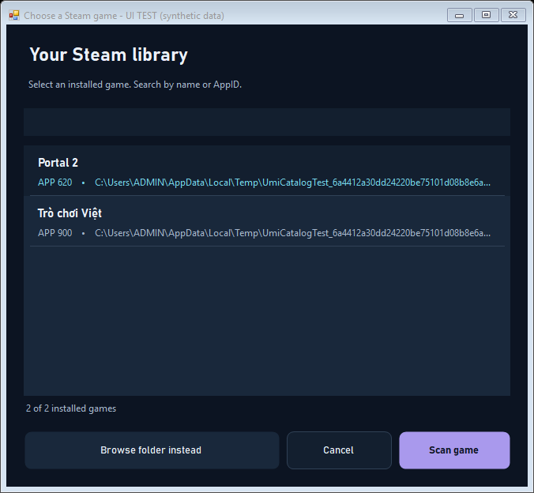
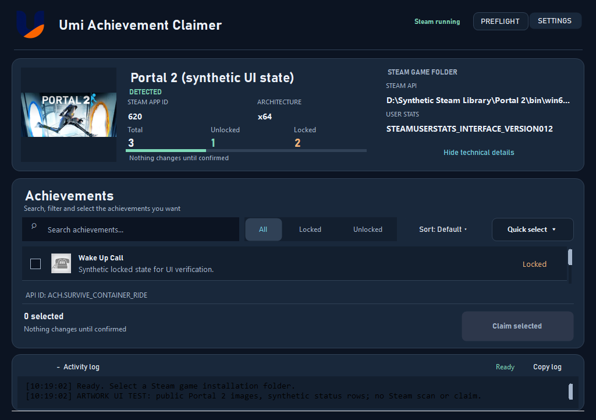
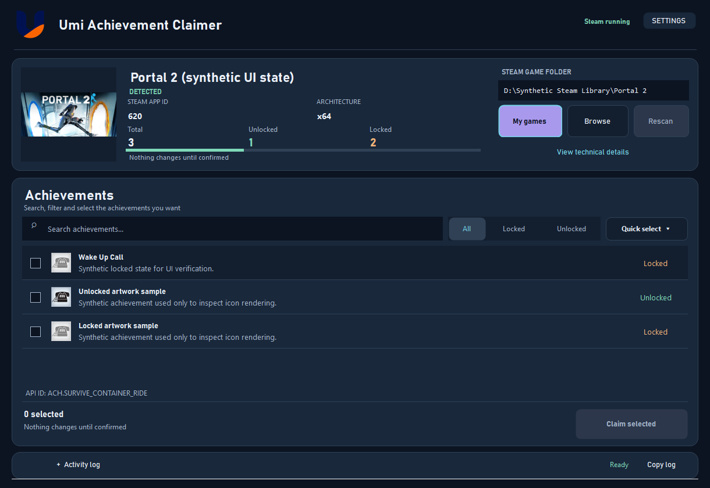

# Umi Achievement Claimer

A lightweight, bilingual **Windows utility** for reviewing Steam game achievements and claiming **only the achievements you explicitly select**.

**English** · [Tiếng Việt](#tiếng-việt) · [Download](#download) · [Build from source](#build-from-source) · [Changelog](docs/CHANGELOG.md)

> **Development status:** The current local source tree includes the Steam Midnight v2 UI and subsequent usability fixes. The published GitHub Releases download may not yet contain these unreleased local changes. Build the source or use the locally built executable to see the exact interface shown below.

## Interface — Steam Midnight v2



*Current native WinForms regression capture with entirely synthetic game information and achievement entries. It is not evidence of a real Steam claim, and Windows-composited titlebar pixels are not part of the verified client render.*

The interface prioritizes three actions: **choose a game → review/select achievements → confirm a claim**.

- **Game summary:** game artwork, detected name, Steam AppID, architecture, counts, unlock-progress bar and folder controls in one full-width row.
- **My games / Browse / Rescan:** the searchable Steam library picker discovers installed games using local appmanifests, including additional Steam library drives; Browse remains available when a game is not listed. Both selection paths start a read-only scan. Rescan repeats the selected path; the displayed path cannot be edited.
- **Achievement explorer:** filter **All / Locked / Unlocked**, search by name, description or API ID, and review icons and status.
- **Quick select:** select visible entries, select visible locked entries or clear all. Filtering never silently discards already selected achievements.
- **Claim footer:** displays exactly how many achievements are selected, including those hidden by your current search/filter. Nothing is claimed until you confirm.
- **Diagnostics:** collapsible Activity log with Copy log, enlarged readable log text, themed scrolling and expandable Steam API details.
- **Appearance:** Steam Midnight, Carbon, Arcade and custom accent themes, plus English/Vietnamese controls in Settings.

### Version 1.11.0: Rarity, Timeline, Dashboard & Recovery

The **Insights** button opens a local dashboard showing games, unlocked counts, snapshots and changes between scans. After each successful read-only scan, the app saves up to 30 distinct snapshots per game. Double-click a game in Insights to inspect its local timeline, or export the active game's latest snapshot as CSV.

- **Rarity:** Steam public global achievement percentages when available. Umi's Common / Rare / Ultra rare tiers are local display classifications.
- **Unlock time:** uses Steamworks GetAchievementAndUnlockTime when the optional native export is supported; otherwise Not available.
- **Recovery:** saves a baseline before an explicitly confirmed Claim; a subsequent read-only scan compares results without attempting another Claim.
- **Updater:** manually checks the official public GitHub Releases feed and may open the official page after your approval. No automatic installation or execution.
- **Privacy:** snapshots are stored under Windows AppData/UmiAchievementClaimer/history, contain no credentials or game paths, and are scoped to the Windows profile plus AppID, not Steam account ID.



*UI regression screenshot uses synthetic data. No Steam account changes were performed for this image.*

See [1.11 quality gate and limitations](docs/QA_V1_11.md).

### Version 1.10.0: Reliability and workflow updates

- Preflight checks Steam process, installation folder, AppID, API source, and worker architecture without changing achievements.
- Running worker operations can be cancelled. List operations time out after 90 seconds; selected claims after 120 seconds. Interrupted outcomes are reported as uncertain and never automatically retried.
- Claim completion distinguishes locally verified Steam API status from accepted requests; it does not prove server synchronization.
- Double-click an achievement to inspect its description, API ID, status and artwork.
- Installed-game library now includes Favorites, Favorites-only, and recently-used ordering. It persists AppIDs only.
- Achievements can be sorted by name, locked first or unlocked first, while preserving explicit selection.
- Run tools/package-release.ps1 to package the tested portable EXE. GitHub Actions builds and tests, publishing only for explicit version tags.

See the quality-gate report in docs/QA_V1_10.md. Tests use synthetic data, not live Steam claims.

### Searchable installed-game library



*Native UI test render using synthetic installed-game manifests. Real Steam library discovery was separately confirmed on the Windows development machine; this screenshot is not an account or game-claim capture.*

The picker searches by **game name or Steam AppID** and includes a manual-folder fallback. Library enumeration runs without freezing the window. Keyboard shortcuts: **Ctrl+L** opens the library, **Ctrl+F** focuses achievement search, and **F5** rescans the current path.

### Expanded diagnostics



*UI regression capture at a smaller window size. Data is synthetic, and no Steam worker or live claim was invoked to create the screenshot.*

## Download

Get the **published release** from [GitHub Releases](https://github.com/TDUmii/UmiAchievementClaimer/releases/latest), or build the newest local source as described below.

**Important:** A GitHub Release can differ from the latest local build. Use `dist\UmiAchievementClaimer.exe` for this updated UI. The repository-root executable may remain older if it was open or locked during a build. `build.ps1` warns and stages the current executable under `dist` instead of interrupting the build.

Local development build checked on **October 23, 2026**:

| Item | Local value |
|---|---|
| Product version reported by the project | `1.11.0` (local build; public release not yet published) |
| Executable | `dist\UmiAchievementClaimer.exe` (latest tested build) |
| Size | Varies by build; check the latest `dist` executable |
| SHA-256 | See `SHA256SUMS.txt` after the latest build |

Verify your **local** file using PowerShell:

```powershell
Get-FileHash -Algorithm SHA256 .\dist\UmiAchievementClaimer.exe
```

The checksum recorded in `SHA256SUMS.txt` is for the local build, **not necessarily the file currently offered by GitHub Releases**. Rebuilding changes the checksum; consult `SHA256SUMS.txt` after building.

## Requirements

- Windows 10 or 11, **64-bit**.
- Steam running and signed in **Online** with a valid session and appropriate game license.
- A supported Steamworks API implementation in the target game's installation.
- Internet access for fetching public artwork when available; the core achievement list does not require artwork to load.

Some games with server-authoritative achievements, anti-cheat restrictions, custom/encrypted Steam APIs, third-party launchers or linked accounts may not support the claim operation.

## How to use

1. **Close the target game**, but keep Steam running in Online mode.
2. Start the current build from `dist\UmiAchievementClaimer.exe` and choose **My games** to select a detected installed title. If the game is not listed, use **Browse** to choose the game's installation directory (not a generic Steam library root). The scan begins automatically after selection.
3. Verify the **game name, AppID and detected architecture** in the game summary. Choose **Rescan** if needed.
4. Review the loaded achievements. Use **Search** and **All / Locked / Unlocked** to narrow the list.
5. Tick only the achievements you intend to claim. **Quick select** provides bulk selection of visible entries, visible locked entries, and Clear all.
6. Review the **selected count** at the bottom of the list. Search/filter changes preserve checked achievements even when hidden.
7. Select **Claim selected**, inspect the **game, AppID and selection count** in the confirmation dialog, then choose whether to proceed. **Cancel** is the safe/default dialog action.
8. Use **Activity log** / **Copy log** for troubleshooting and **View technical details** to inspect Steam API detection. Open **Settings** for language or theme changes.

**Safety by design:** Scanning is read-only; claiming is never automatic. The app asks for explicit confirmation and does not intentionally edit or delete game save files. Changing achievement state may affect your Steam profile and may not be fully reversible.

## Game artwork and fallback

The app tries public Steam metadata and Steam CDN images for the game cover and achievement icons. If the game cover is unavailable online, it also attempts to read an existing local Steam artwork cache, including nested `library_header.jpg`, `library_capsule.jpg` or `library_hero.jpg` files.

For example, an installation may already have artwork under:

```text
C:\Program Files (x86)\Steam\appcache\librarycache\<SteamAppID>\
```

If no supported artwork is found, the interface shows a neutral placeholder. A missing image **does not prevent** scanning, selecting or confirming achievements. Artwork availability depends on Steam metadata and what the local client has cached. Public-artwork requests do not upload your installation path or account credentials.

## Appearance and controls

The application opens in **English**. Open **Settings** to switch **EN / VI** and choose **Steam Midnight**, **Carbon**, **Arcade** or a custom accent. The selected theme is persisted in:

```text
%APPDATA%\UmiAchievementClaimer\theme.cfg
```

Keyboard navigation is supported. **Ctrl+L** opens the installed-game picker, **Ctrl+F** focuses achievement search and **F5** rescans the selected game. Buttons and list rows preserve keyboard focus feedback without permanently highlighting controls after mouse interactions. The activity log, achievement list and game picker use matching themed scrollbars.

## Build from source

Use Windows PowerShell and the .NET Framework 4.x compilers supplied with Windows. This project does not require NuGet packages for the documented build.

```powershell
git clone https://github.com/TDUmii/UmiAchievementClaimer.git
cd UmiAchievementClaimer
Set-ExecutionPolicy -Scope Process Bypass
.\build.ps1
```

The build places the newest executable in `dist\UmiAchievementClaimer.exe` and attempts to copy it into the repository root. When the root executable is locked by Windows, the build still succeeds in `dist` and the UI test runner uses the newest `dist` build.

### UI regression tests

```powershell
.\tests\run-ui.ps1

# Optional: download public Portal 2 artwork test fixtures first
.\tests\run-artwork.ps1
.\tests\run-ui.ps1 -SkipBuild
```

The latest local UI run completed **112 PASS / 0 FAIL** (October 23, 2026). The suite exercises synthetic game data, filtering, selection persistence, confirmation safety, settings, window geometry, and generated renders. It **does not** claim real Steam achievements or prove compatibility with any individual game. The 150% UI check simulates scaling rather than using a physical high-DPI screen. Native title-bar compositing is not captured by `DrawToBitmap`.

Render outputs are written to the ignored `.impeccable/review/` directory. The checked-in README screenshots were copied from those render outputs and show the current design without bundling Steam artwork into the application.

## Project layout

```text
src/App/                Application entry point
src/UI/                 WinForms UI, theme, artwork and dialogs
src/Core/               Core models and behaviors
src/Detection/          Game and Steam API detection
src/Worker/             Isolated Steam workers
assets/                 Application branding and icons
docs/images/            README screenshots and provenance notes
tests/                  Native UI and artwork test harnesses
tools/                  Development utilities
build.ps1               Windows build script
```

See [Architecture](docs/ARCHITECTURE.md), [Design system](DESIGN.md), [Product decisions](PRODUCT.md), [UI/UX quality gate](docs/UI_UX_QA_2026-10-23.md), and [Changelog](docs/CHANGELOG.md).

## Limitations and responsible use

Use the tool **only** with games and Steam accounts you are authorized to access. Claim operations modify Steam achievement/profile state and may not be reversible. Compatibility varies by game, Steamworks version, online/account status, DLC, server policies and third-party launchers. The app reports unsupported cases rather than using unsafe runtime-memory extraction.

**License:** No license file is included in this repository as of the local review; public source access does not by itself grant reuse rights.

---

# Tiếng Việt

**Umi Achievement Claimer** là ứng dụng Windows gọn nhẹ giúp nhận diện game Steam, xem trạng thái thành tích và chỉ claim những achievement mà người dùng **chủ động lựa chọn**. Giao diện hỗ trợ tiếng Anh và tiếng Việt.

> **Lưu ý về phiên bản:** Bộ mã nguồn hiện tại trên máy đã có Steam Midnight v2 và các bản sửa UI gần nhất. File trên GitHub Releases có thể vẫn là bản cũ nếu thay đổi chưa được commit, push và phát hành.

## Giao diện mới



*Ảnh render ứng dụng WinForms tại 1220 × 840, dùng ảnh công khai của Portal 2 nhưng dữ liệu game/achievement để kiểm thử là **giả lập**. Đây không phải ảnh ghi nhận quá trình claim thành tích thật.*

Thay đổi nổi bật:

- **Thông tin game nằm ngang:** ảnh bìa, tên game, AppID, kiến trúc, số thành tích đã/chưa mở và thanh tiến độ.
- **Thư viện Steam tự động:** bấm **My games / Thư viện** để xem danh sách game đã cài, tìm theo tên hoặc AppID. Nếu không tìm thấy, dùng **Browse / Thư mục** để chọn thư mục thủ công; **Rescan / Quét lại** để quét lại. Quét không khóa giao diện.
- **Tìm kiếm và lọc:** tìm achievement bằng tên, mô tả hoặc API ID; chọn **All / Locked / Unlocked**.
- **Quick select:** chọn tất cả mục đang hiện, chọn mục chưa mở đang hiện hoặc bỏ chọn toàn bộ.
- **Claim an toàn:** hiển thị số mục đã chọn, kể cả mục bị ẩn bởi bộ lọc; luôn yêu cầu xác nhận trước khi thực hiện.
- **Activity log:** có thể mở rộng, sao chép nhật ký, xem chi tiết kỹ thuật; giao diện và thanh cuộn đồng bộ với danh sách.
- **Cá nhân hóa:** hỗ trợ giao diện Steam Midnight, Carbon, Arcade, màu nhấn tự chọn và chuyển đổi EN/VI.

### Activity log và chi tiết kỹ thuật


*Ảnh kiểm thử tại kích thước cửa sổ nhỏ; không thao tác với thành tích Steam thật.*

## Tải và chạy

Tải bản phát hành công khai tại [GitHub Releases](https://github.com/TDUmii/UmiAchievementClaimer/releases/latest). Nếu muốn sử dụng giao diện mới nhất, hãy chạy `dist\UmiAchievementClaimer.exe` hoặc build từ mã nguồn mới nhất. Bản EXE ở thư mục gốc có thể cũ hơn nếu đang bị Windows khóa.

**Yêu cầu:** Windows 10/11 64-bit, Steam đang chạy ở chế độ Online và tài khoản có quyền dùng game. Một số game dùng hệ thống thành tích phía máy chủ, anti-cheat hoặc Steam API đặc biệt có thể không tương thích.

### Hướng dẫn sử dụng

1. Đóng game cần thao tác nhưng **giữ Steam đang chạy** ở chế độ Online.
2. Chạy bản mới tại `dist\UmiAchievementClaimer.exe`, bấm **My games / Thư viện** để chọn game đã cài; nếu không thấy game, dùng **Browse / Thư mục** và chọn đúng thư mục cài game.
3. Kiểm tra tên game, AppID và kiến trúc sau khi quét. Nếu cần, bấm **Rescan**.
4. Tìm kiếm, lọc và tick các achievement bạn thật sự muốn claim.
5. Dùng **Quick select** nếu cần chọn hàng loạt. Việc chuyển bộ lọc không làm mất các lựa chọn trước đó.
6. Kiểm tra số lượng đã chọn và bấm **Claim selected**.
7. Đọc cửa sổ xác nhận (game, AppID, số lượng), sau đó quyết định có thực hiện hay không. Nút **Cancel** là lựa chọn mặc định.
8. Mở **Activity log** để xem lỗi, dùng **Copy log** để sao chép nhật ký hoặc mở **View technical details** để xem thông tin Steam API.

### Ảnh game không hiển thị

Ứng dụng ưu tiên tải ảnh công khai từ Steam. Nếu không tải được ảnh bìa online, nó thử tìm ảnh đã có trong cache Steam trên máy, ví dụ `library_header.jpg`, `library_capsule.jpg` và `library_hero.jpg`. Trường hợp không có ảnh phù hợp, giao diện hiển thị ảnh thay thế; **việc thiếu ảnh không ảnh hưởng đến tính năng quét và lựa chọn thành tích**.

### Đổi ngôn ngữ và màu giao diện

Vào **Settings** để chuyển giữa tiếng Anh/Việt hoặc chọn theme. Phím tắt: **Ctrl+L** mở thư viện, **Ctrl+F** tìm achievement, **F5** quét lại. Thiết lập màu được lưu tại `%APPDATA%\UmiAchievementClaimer\theme.cfg`.

### Tự build và kiểm thử

Mở PowerShell trong thư mục dự án:

```powershell
Set-ExecutionPolicy -Scope Process Bypass
.\build.ps1
.\tests\run-ui.ps1
```

Kết quả kiểm thử UI gần nhất trên máy phát triển: **112 PASS, 0 FAIL** (ngày 23/10/2026). Đây là bài kiểm thử với dữ liệu giả lập, **không phải** chứng nhận tính tương thích claim với mọi game Steam. File EXE trên máy sau lần build được ghi checksum trong `SHA256SUMS.txt`.

## Lưu ý an toàn

- Quét chỉ đọc thông tin; ứng dụng không tự claim hoặc tự chọn achievement.
- Mọi thao tác claim phải do người dùng lựa chọn và xác nhận.
- Việc thay đổi achievement có thể ảnh hưởng hồ sơ Steam và **không đảm bảo hoàn tác được**.
- Chỉ sử dụng với game và tài khoản Steam mà bạn có quyền truy cập.

**Giấy phép:** Repo hiện chưa có file LICENSE. Tham khảo [mã nguồn](https://github.com/TDUmii/UmiAchievementClaimer), [kiến trúc](docs/ARCHITECTURE.md) và [lịch sử thay đổi](docs/CHANGELOG.md).
