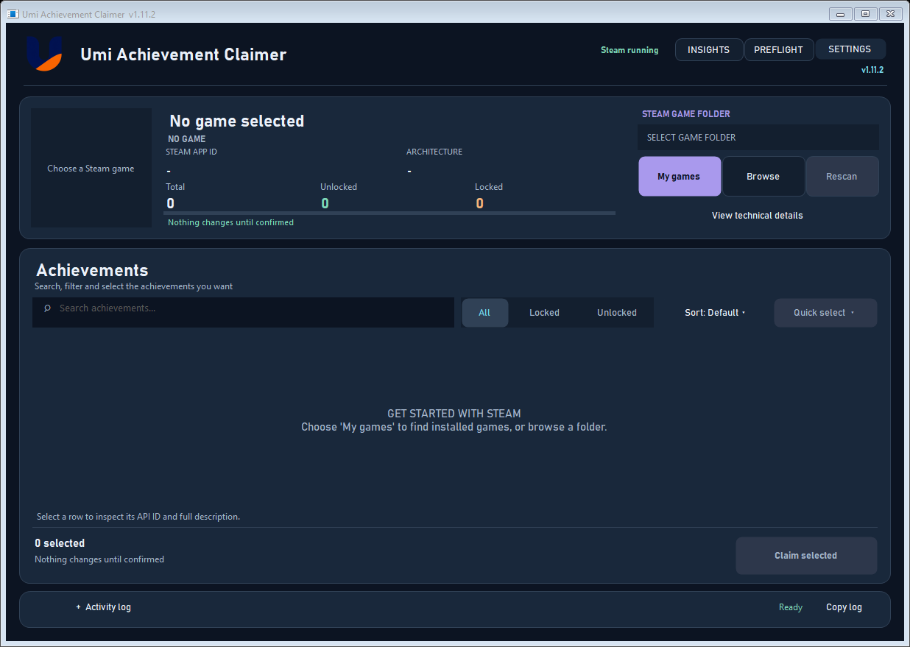
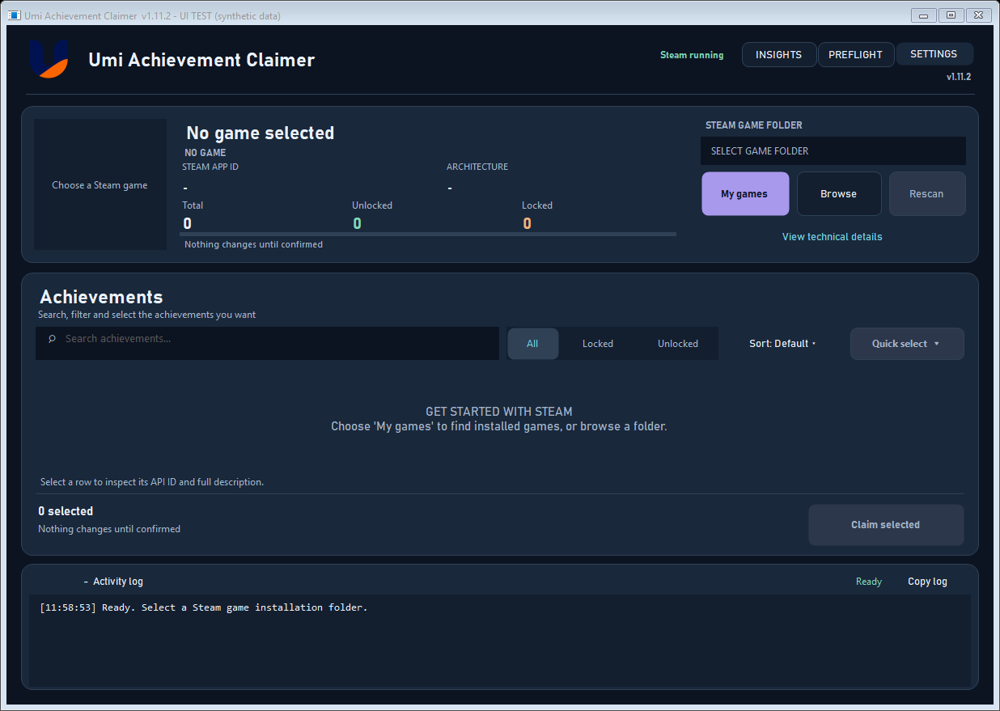
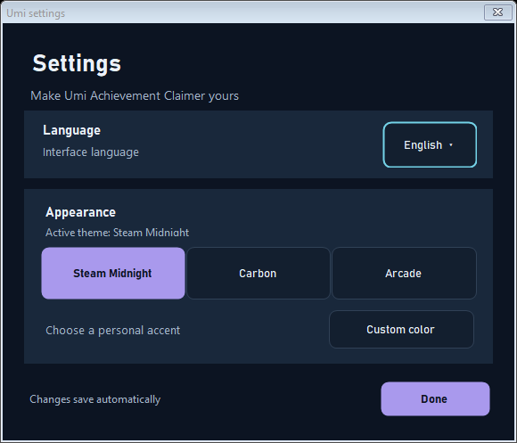
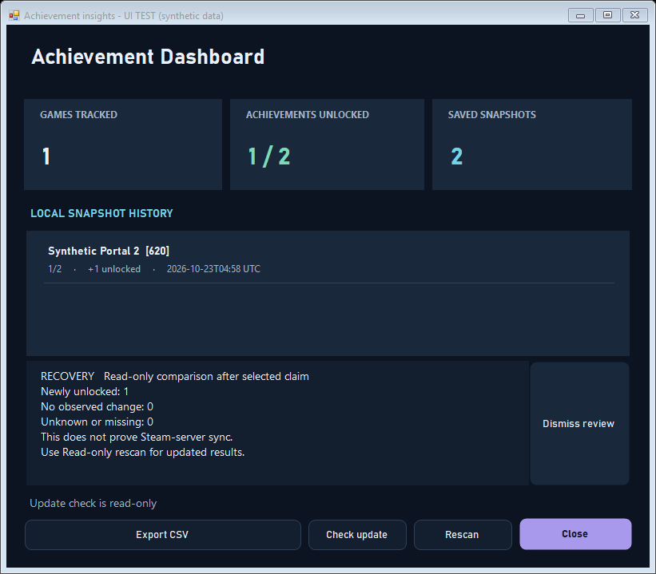

# Umi Achievement Claimer

**A lightweight, bilingual Windows desktop utility for discovering Steam games, inspecting achievements and changing only the achievements you explicitly select.**

[English](#english) · [Tiếng Việt](#tiếng-việt) · [Build & tests](#build-and-tests) · [Changelog](docs/CHANGELOG.md) · [GitHub Actions](https://github.com/TDUmii/UmiAchievementClaimer/actions)

**Current source version: 1.11.2** · Windows x64 · Portable EXE · English / Tiếng Việt

> The newest development build is `dist/UmiAchievementClaimer.exe`. GitHub Releases may offer an older version until a release is explicitly tagged. The app displays its exact version at the top-right of the main window and in the window title.

## English

### Interface



*Native WinForms client render with synthetic data; this is not a live Steam account or proof that claiming works in a particular game.*



**What's included**

- **Game library:** discovers locally installed Steam games, including additional Steam libraries. Search by name or AppID, favorite titles, and revisit recently selected games. Use **Browse** when detection is unavailable.
- **Achievement explorer:** read-only scan, game artwork when available, API ID and description, filters, sorting, explicit multi-selection and a confirmation dialog before any Claim.
- **Steam preflight and diagnostics:** check Steam process, AppID, installation path and API detection; view technical details, copy Activity log, cancel a worker or let its timeout stop it.
- **Verification and recovery:** review local API readback after Claim, compare a previous snapshot to a later *read-only* scan, and inspect uncertain or interrupted results. Neither verification nor snapshots independently prove Steam-server synchronization.
- **Insights:** global rarity where Steam publishes it, unlock time where the game's Steam API provides it, local progress snapshots, a timeline, CSV export and a manual check for public GitHub releases. Local snapshot history is limited to 30 distinct states per AppID.
- **Bilingual appearance:** English/Vietnamese, Steam Midnight, Carbon, Arcade and optional custom accent.





### Getting started

1. Keep Steam running and signed in. Close the target game before attempting a Claim.
2. Launch `dist/UmiAchievementClaimer.exe`. Choose **My games**, or **Browse** to select the target game's installation folder.
3. Check the game name, Steam AppID and architecture. Use **Preflight** to inspect local prerequisites.
4. Inspect achievements. You may search, filter, sort or open details. Check only the items you intend to change.
5. Choose **Claim selected** and review the separate confirmation. **Cancel** is the default safe action.
6. After an operation, inspect **Activity log** and, if needed, perform a new read-only scan before trusting any state changes.

**Games without achievements:** a successful scan that reports zero achievements shows a clear empty state and keeps Claim disabled. A failed scan is reported separately rather than being treated as an empty game.

**Missing artwork:** the application can use public Steam images or existing local Steam artwork cache. An image failing to load does not prevent achievement listing.

**Keyboard:** `Ctrl+L` opens installed games, `Ctrl+F` focuses achievement search, `F5` rescans the selected folder.

### Downloads and local data

The canonical executable is always **`dist/UmiAchievementClaimer.exe`**. To create a portable archive and checksums:

```powershell
.\tools\package-release.ps1
```

This produces `dist/UmiAchievementClaimer-v1.11.2-windows-x64-portable.zip` and `dist/SHA256SUMS.release.txt`. **Only after the new archive is successfully created, older versioned ZIPs in `dist` are deleted.** The build no longer creates a duplicate EXE in the repository root.

Personal preferences and optional snapshot history reside in `%APPDATA%\UmiAchievementClaimer`. Build cleanup never deletes this data. Snapshot history is scoped by **Windows user profile + Steam AppID**, not Steam account; avoid sharing a Windows profile across Steam accounts if you require account-specific historical comparisons.

### Build and tests

Requirements: Windows 10/11 x64, .NET Framework 4.x C# compilers from Windows, and PowerShell. No NuGet dependency is needed for the documented build.

```powershell
git clone https://github.com/TDUmii/UmiAchievementClaimer.git
cd UmiAchievementClaimer
.\build.ps1
.\tests\run-ui.ps1
.\tools\package-release.ps1 -SkipBuild -SkipTests
```

The source build embeds isolated x86/x64 workers in a single Windows desktop EXE. The local **1.11.2 regression suite (122 PASS / 0 FAIL)** includes checks that a hidden idle ProgressBar never leaves a one-pixel line under the Activity log, that the version label matches assembly metadata, and that the progress indicator appears only during work. The suite uses synthetic game and worker data; it **does not** perform a real Claim.

See [UI review and test evidence](docs/QA_V1_11_2_UI.md), [Architecture](docs/ARCHITECTURE.md), [Design notes](DESIGN.md), [Product notes](PRODUCT.md) and [Changelog](docs/CHANGELOG.md).

### Safety and limits

Use only with games and accounts you are authorized to access. Steamworks behavior varies by title, version, online state, anti-cheat, server-authoritative achievements and third-party launchers. A changed achievement may not be reversible. The tool never claims automatically, never retries a failed Claim automatically, and should not be represented as universally compatible with all Steam games. There is currently no LICENSE file in this repository; public access to the source does not by itself grant reuse rights.

---

## Tiếng Việt

**Umi Achievement Claimer** là công cụ Windows giúp tìm game Steam đã cài, xem thành tích và chỉ thay đổi các achievement mà người dùng **tự chọn và xác nhận**.

**Phiên bản mã nguồn hiện tại: 1.11.2.** Số phiên bản hiển thị ở góc trên bên phải và trên thanh tiêu đề. File chạy mới nhất nằm tại `dist\UmiAchievementClaimer.exe`, không phải thư mục gốc dự án.

### Chức năng

- **Thư viện game:** tự tìm game Steam trên nhiều ổ đĩa, tìm theo tên/AppID, đánh dấu yêu thích, sắp xếp game gần đây; có thể chọn thư mục thủ công.
- **Quản lý achievement:** quét chỉ đọc, xem tên, trạng thái, mô tả, tỷ lệ hiếm và thời gian mở khóa (nếu Steam cung cấp); tìm kiếm, lọc, sắp xếp, chọn và xác nhận trước khi Claim.
- **Kiểm tra và xử lý lỗi:** Preflight, Activity log, sao chép log, hủy và timeout; thông báo rõ khi không thể xác nhận trạng thái.
- **Insights & Recovery:** thống kê, lưu tối đa 30 snapshot khác nhau mỗi AppID, xem lịch sử thay đổi, xuất CSV và đối chiếu trước/sau Claim bằng cách quét lại chỉ đọc; không tự Claim lại.
- **Cài đặt:** tiếng Việt/Anh, giao diện Steam Midnight/Carbon/Arcade, màu tùy chỉnh.
- **Game không có achievement:** ứng dụng hiển thị thông báo riêng và vô hiệu hóa Claim, không tự xem kết quả 0 thành tích là lỗi.

### Sử dụng nhanh

1. Mở Steam và đăng nhập Online; nên đóng game đang cần thao tác.
2. Chạy `dist\UmiAchievementClaimer.exe`, nhấn **My games / Thư viện** hoặc **Browse / Thư mục**.
3. Kiểm tra tên game, AppID và thông tin Preflight.
4. Tìm và chọn các thành tích cần thay đổi; nhấn **Claim selected** và đọc kỹ cửa sổ xác nhận.
5. Kiểm tra Activity log, sau đó quét lại nếu cần xác minh trạng thái.

Phím tắt: `Ctrl+L` mở thư viện, `Ctrl+F` tìm achievement, `F5` quét lại.

### Build, kiểm thử và giải phóng dung lượng

```powershell
.\build.ps1
.\tests\run-ui.ps1
.\tools\package-release.ps1 -SkipBuild -SkipTests
```

Sau khi tạo gói portable mới thành công, chương trình đóng gói sẽ **tự xóa các ZIP phiên bản cũ trong `dist`**, chỉ giữ bản đang dùng. Các file đã commit vẫn tra cứu được trong lịch sử Git. Thư mục cấu hình/snapshot trong `%APPDATA%\UmiAchievementClaimer` được giữ nguyên.

**Lưu ý an toàn:** quét không thay đổi thành tích; Claim cần người dùng xác nhận. Một số game không tương thích với Steam API hoặc dùng achievement phía máy chủ. Dữ liệu kiểm thử UI giả lập không chứng minh Claim thành công trên Steam thực tế.

Xem [báo cáo UI 1.11.2](docs/QA_V1_11_2_UI.md) và [lịch sử thay đổi](docs/CHANGELOG.md).
